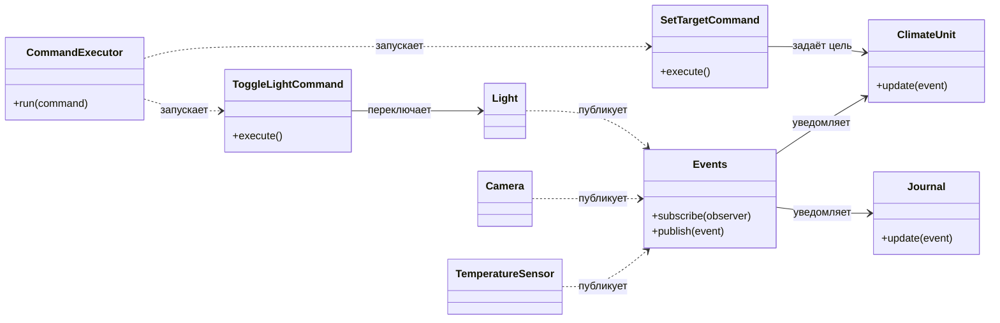
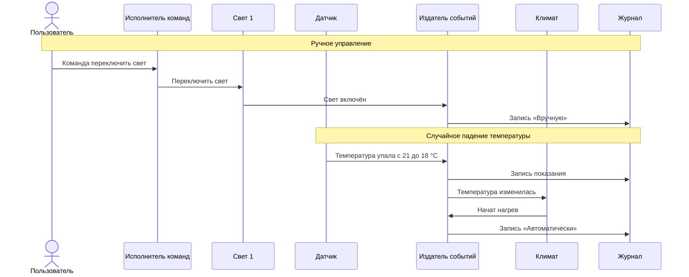

# UML умного дома

## Диаграмма классов

[Открыть в Mermaid Live](https://mermaid.live/edit#pako:eNqVU8FKw0AQ_ZWQU4q2H9BDL9qL9GTrzcsmGdOFZFM2u0UpBW1BL6L4J1ValFbsL-z-kZNsxMQkUPe0vHlv3gxvd2Z7sQ9217K9kCTJKSUBJ9Els_D4lIMnaMyswblBMo51EkcRYX7_GjwpYm7NTDE9R1wyxzP1loHnRekoDoIQBjQYi7xLSQ1ZS3DqpEMQI8ID-LcwcyvNTyLgpDQWRBOEhOQwBJbEvEQPaUQEXDAqSp5y4iPswBSYqPPtp4WkJEmkm3icuuDEbgJ8CrxVqE6kG9Jk3NzxLJackfCAKczlb1CdTq8uga6l3tVK7fVS36kt3jZ60dygkkOzvMar3e6ZQFLZHqm3aoOinX7SD0VpxSUVFpPIXddqpV_0wtL32GenH43aOKTT5iGkZnqpXtVOfagt3n5XzB7DYdzKMzlMlhOqGyDpDcdeqy_1icM_10p-Qm-i28eWjStEhPr4jWe2GEOUfWgfrogMhT1HAsH4hjfMQ1xwCYiYd5P_9xyefwOORI-A)

## Диаграмма последовательности

[Открыть в Mermaid Live](https://mermaid.live/edit#pako:eNqNVE1v00AQ_Ssjn9tDOCEfegFuiEvVWy8rZ0ktESfY64qqqtSkhxyKyocQICQE5crFDbXiJq0j5RfM_iPe7Dq0IkElBzuevPfmzZuND4Oo19ZBSEGmX-Y6ifTjWHVS1d1NCB8VmV5KO5lOSWXE37jmmX3NE9zHXNghl_LssX2VmjiK-yox9OSVjnKhCuuzHfBcmHzD1ZJDPEXpmgsUL1cFnsadPePY5-hU2iG1VkHbOsmaHh_EjR1xxdM1bvZ1YjLvBd4vb50TrNV8YU9RqPhqlbqTxN7GF9ivxK8drnHb6zjQR3tijzFQwbPdxMOe9Yym3r72KW4AGRJ_B24EXM0l2ROeg1RgzBlMISIuPVUIm1tbyyxDMfEnMi4IoZZglkhyZs9keETgRnKJeZElG0Iu01C2eD_NYaW5iy68XQNuDc--45umhwNJBzfdJzicQ3UA1cVPfm-P_bi4ni3WBOPX2ERzDnFBF3zVBAStAvM20ZBb3XUzuywdkdtTr-mV7tr-sQpGcpK5LEm-DuhBi6BfU-shLYpH947kzvIUhYnbRGXf_EWRM_PP1phhgrKfBgZEslk3aHetf8WPI2GSO1G_3M7G_5P4Wx4jpdqfVpRH8DCA5UrSDzYo6Oq0q-I2_vaHgdnTXfcCaOvnKn9hgiMAFI7M9kESoW7SXKOS99vKLF8OTfnoNwaELl4)

